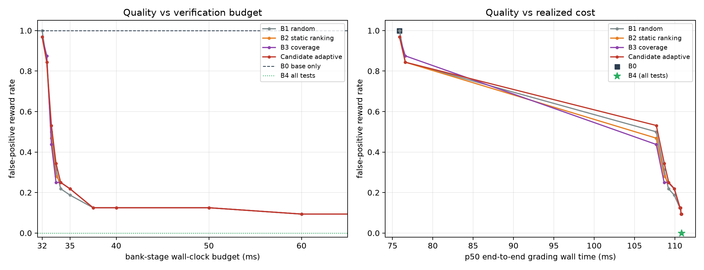
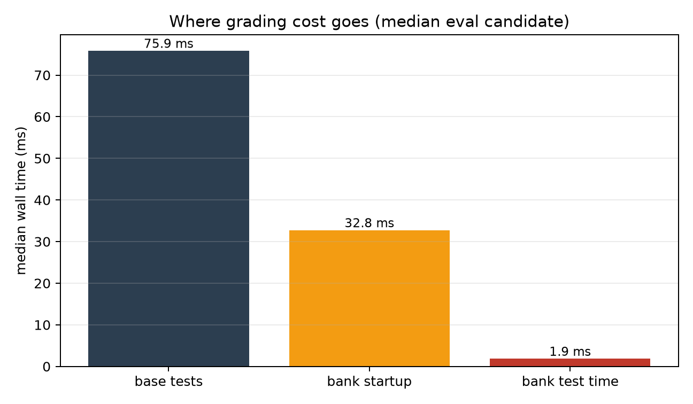

# RewardForge

RewardForge is a research prototype for **cost-controlled executable rewards** in
code-generation RL. The project question is whether an adaptive test-selection
policy can detect more incorrect base-test-passing programs than strong static
test subsets at the **same measured verification cost**.

This repository implements the **first, CPU-only falsification experiment** from
`RewardForge_Feasibility_and_Phase1.md`. It does **not** implement P3–P5 (RL
integration, GPU training, publication). The experiment decides whether those
later phases are justified.

## Result: NO-GO at the first gate

The experiment ran end-to-end on 966 natural candidate programs from 6 pinned
EvalPlus release artifacts, 322 HumanEval+/MBPP+ tasks, and ~124k bank/audit test executions (all 966 candidates audited).

| Gate | Result | Evidence |
|---|---|---|
| 1. Natural signal | **PASS** | 32 eval base-pass/audit-fail candidates across 27 tasks (target ≥30) |
| 2. Adaptive gain | **FAIL** | Best relative FPR reduction was **0.0%**, not the pre-registered ≥30%; the candidate never beat the best static baseline |
| 3. False rejection | **PASS** | Candidate 0.4% vs all-tests reference 0.4% (both 1/247) |
| 4. Disjoint generalization | **FAIL** | No generator-holdout gain ≥30% |
| 5. Cost realism | **FAIL** | Median bank test time is 1.86 ms; bank startup is 32.75 ms (94% of the bank stage). All-tests adds ~35 ms to a ~111 ms grading call |

**Overall: NO-GO (first-experiment gate).** The audit itself is useful: among
base-passing candidates, 12.5% were independently audited as incorrect (11.5%
on the held-out eval split). But the adaptive-selection premise does not
survive the measured cost structure.

Read the full report: [`artifacts/experiment/report.md`](artifacts/experiment/report.md).





## What was implemented

### P1 — audit harness

- Pinned EvalPlus datasets and candidate assets with SHA-256 (see
  [`data/manifest.json`](data/manifest.json)).
- Natural candidate corpus: GPT-4, ChatGPT, CodeGen, and DeepSeek-Coder release
  programs (no mutated programs as primary evidence).
- Per-task split of the enhanced suite into:
  - **base tests** — the weak reward (original HumanEval `check()` / MBPP+ base
    `test_list`);
  - **candidate bank** — available to the reward policy;
  - **private audit** — never loaded by the policy and never sent to the
    candidate process.
- Every bank/audit case was validated against the canonical solution twice;
  invalid, nondeterministic, non-parser-compatible, and oversized cases were
  quarantined before the split.
- Sandboxed worker: separate process, JSON argument-only protocol, expected
  values held by the supervisor, CPU/file/process limits, wall-clock timeout,
  best-effort network block, optional macOS `sandbox-exec`.
- Task × candidate × test result table and candidate-level confusion matrix.
- All 966 candidates are audited; only base-passing candidates enter the
  reward-policy comparison.

### P2 — budgeted replay

- `B0` base tests only.
- `B1` random bank order, early stop on failure.
- `B2` strongest static dev-only ranking (cluster failure rate / cost).
- `B3` dev-only greedy coverage/set-cover ranking.
- `Candidate` sequential Bayesian mixture over development failure profiles,
  with a coverage-novelty term.
- `B4` all bank tests (cost/quality reference, not budget-matched).
- Replay charges **measured** per-test wall/CPU time plus measured bank-worker
  startup; all methods get the same budget per candidate.
- Task-clustered bootstrap CIs for FPR and paired candidate–baseline
  differences; results by benchmark, generator, and a descriptive difficulty proxy;
generator-holdout check.

The policy only reads `data/processed/tasks_public.jsonl`. Private audit cases
and graders live in `data/private/` and are loaded by the audit supervisor only.

## Reproduce

Requirements: Python ≥3.11 (tested on 3.14), macOS or Linux, no GPU. Network is
needed for the one-time pinned download (~14 MB).

```bash
python3 -m venv .venv
.venv/bin/pip install -e ".[dev]"

# 1. Download pinned data, build/validate the corpus (~1 min)
.venv/bin/python -m rewardforge.cli prepare

# 2. Run the P1 audit matrix (~3 min on the test host)
.venv/bin/python -m rewardforge.cli audit

# 3. Run the P2 budgeted replay, CIs, charts, and report (~20 s)
.venv/bin/python -m rewardforge.cli experiment

# Or all three:
make all

# Tests
make test
```

The exact config is [`configs/default.json`](configs/default.json). It pins the
seed, dev/eval task counts, per-task bank/audit caps, generators, sandbox
limits, and budget grid. `prepare` is safe to rerun; `audit` resumes by
candidate ID unless `--no-resume` is passed.

### Reproducibility details

- HumanEval+ revision: `d32357cf319e50e9c8d8dab5ea876c72b0fd321b`
- MBPP+ revision: `b2d74c91837c3f2a20c1299ae98133cbe7cfa077`
- HumanEval revision: `b9453e8f1865df0a0057a1383767caa400acfbcf`
- EvalPlus candidate releases: `v0.1.0` (HumanEval) and `v0.2.0` (MBPP)
- Every download is SHA-256 verified against `rewardforge/download.py` and
  recorded in `data/manifest.json`.
- Task selection is deterministic by seed and task ID; dev/eval are disjoint.
- Corpus: 160 dev tasks + 162 eval tasks, 966 candidates, 20,748 bank cases,
  20,685 audit cases.
- Nine tasks were excluded before splitting because they had too few valid
  additional cases or an inconsistent canonical/test contract (e.g.
  `HumanEval/32`, `Mbpp/596`). The full list is in `data/processed/splits.json`.

## Layout

```text
rewardforge/
  download.py    pinned downloads + hashes
  prepare.py     corpus construction, canonical validation, bank/audit split
  testspec.py    EvalPlus test parsing, checker reconstruction, features
  codec.py       JSON-safe tuple/set/inf/bytes codec (no pickle)
  _worker.py     standalone candidate worker (argument-only protocol)
  sandbox.py     supervisor, timeouts, limits, sandbox-exec support
  audit.py       P1 audit matrix + audit_summary.json/cases.csv
  policies.py    B0–B4 + adaptive mixture + replay
  experiment.py  budgets, bootstrap CIs, frontier, charts, report
  cli.py         `rewardforge prepare|audit|experiment|all`
artifacts/
  audit/         matrix.jsonl, cases.csv, candidates.csv, audit_summary.json
  experiment/    replay.csv, frontier.csv, metrics.json, report.md, figures
data/
  raw/           pinned downloads (gitignored)
  processed/     public tasks + candidates (gitignored)
  private/       audit cases + graders (gitignored)
```

## Important limitations

- **Cost structure:** the pilot runs one worker per suite, so startup is
  amortized over all tests. A per-test-container design would have a different
  cost structure; that is a separate experiment, not a rescaled version of this
  result.
- **Audit label:** the private audit set is a held-out subset of EvalPlus, not
  a proof of program correctness. Bank/audit tests are sampled; detection power
  is finite.
- **Candidate distribution:** public model outputs, not a fresh RL policy.
- **Sample size:** 32 eval false positives is just above the pre-registered
  minimum. The CIs are wide; do not interpret the point estimate as a precise
  rate.
- **Sandbox hardening:** on the test host the DSH process sandbox rejected
  nested `sandbox_apply`, so the run used `rlimit+netpatch`. That blocks normal
  socket use and enforces resource limits, but is **not** a kernel boundary for
  adversarial code. On a normal host, set `sandbox.sandbox_exec` to `on` (or
  run in a container) for untrusted code. Private audit files are never copied
  into the worker temp directory, but the fallback process shares the user's
  file permissions.
- **No RL claim:** this is a CPU-only reward-verification study. No model was
  trained and no downstream learning claim is made.

## Why this is a useful negative result

The guide's Gate 5 anticipated exactly this failure mode. At the median eval
candidate, all 80 bank tests cost ~1.9 ms while starting the bank worker costs
~32.9 ms; the full call is ~112 ms. A test-selection policy can save at most
~1.7% of the median call, while running all tests already reaches FPR 0 at
essentially the same p50 cost. The residual 3 false positives at a 160 ms
budget come from slow-tail tests; all-tests pays a higher p95 but removes them.

The reusable contribution is the audit infrastructure and the measurement:
pinned corpus, public/private separation, deterministic validation, measured
costs, and a reproducible negative result. Per the guide, the next step is not
an RL wrapper around this weak result.

## Data and licenses

See [`DATA_CARD.md`](DATA_CARD.md). HumanEval is MIT; EvalPlus datasets are
Apache-2.0; MBPP is the Google Research release (see upstream terms). Candidate
programs are public model outputs from EvalPlus release artifacts. Verify
upstream licenses before redistribution.
